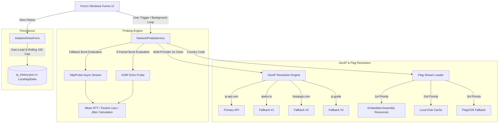

<div align="center">

# 🌐 Iranian Internet & Censorship Monitor

**A high-precision, low-level network diagnostic monitor and censorship analyzer designed for Iranian internet connectivity, domestic intranet routes (NIN), international sanction blocks (Tahrim), and state-level DPI filtering.**

[](https://github.com/mahziyar-azz/ping-app/releases)
[](https://dotnet.microsoft.com/download/dotnet-framework/net472)
[](https://github.com/mahziyar-azz/ping-app)
[](LICENSE)
[](https://github.com/mahziyar-azz/ping-app)

<br/>

[Key Features](#-key-features) • [Network Architecture](#-system-architecture) • [Target Matrix](#-categorized-probing-targets) • [Build & Development](#-build--development) • [Troubleshooting](#-troubleshooting)

</div>

---

## 🌟 Key Features

### 1. ⚡ Advanced Burst Probing & Jitter Measurement
- **3-Packet Burst Statistical Analysis:** Sends multi-sample probe bursts per endpoint to calculate:
  - **Mean Round-Trip Time (RTT in ms)**
  - **Packet Loss Percentage (`%`)**
  - **Mean Absolute Packet Jitter ($\pm\text{ms}$)**
- **Smart Dual-Protocol Adaptation:** Automatically falls back between low-level raw ICMP echo probes and asynchronous HTTP/HTTPS burst requests when ICMP is throttled by intermediate middleboxes.

### 2. 🎨 Dynamic Visual Latency & Quality Grading
Pings are color-coded in real-time based on strict performance and route health thresholds:

| Quality Tier | Latency Threshold | Color Indicator | Typical Meaning |
| :--- | :--- | :--- | :--- |
| **Optimal** | `< 80 ms` | 🟢 Dark Green (`#006400`) | Domestic routing / High-speed direct IXP |
| **Good** | `80 – 160 ms` | 🟢 Lime Green (`#32CD32`) | Standard international routing (Europe/Middle East) |
| **Moderate** | `160 – 260 ms` | 🟡 Amber Orange (`#FF8C00`) | Elevated latency / CDN detour routes |
| **Degraded** | `> 260 ms` | 🔴 Crimson (`#DC143C`) | Severe congestion, throttling, or satellite links |
| **Impaired** | Any `Loss > 0%` | ⚠️ Highlighted with `%` | Packet drops / DPI queue buffer overflows |

### 3. 🎯 Deep Status Code & Censorship Fingerprinting
Distinguishes between network loss, state filtering, and international sanctions:
- **`200 OK / 3xx Redirect`:** Accessible and clean route.
- **`403 Forbidden / 451 Unavailable For Legal Reasons`:** **Sanction Blocked (Tahrim)** — Destination provider or Cloudflare is actively blocking Iranian ASN/IP ranges.
- **`Timeout (> 1200ms)`:** **DPI / Silent Drop** — Packet inspection firewall silently discarding SYN packets.
- **`Connection Refused / TCP RST`:** **Active DPI Reset Injection** — Firewall sending TCP RST flags to kill handshake.

### 4. 🌍 100% Offline Embedded Flag Library
- **304 Embedded Country Flags (`w40` PNGs):** Directly compiled into the executable as binary assembly manifest resources (`ping2.Resources.flags.*.png`).
- **3-Tier Graceful Resolution:**
  $$\text{Assembly Manifest Resource (Instant)} \longrightarrow \text{Local File System} \longrightarrow \text{CDN Remote Stream}$$
- **Zero Latency UI:** Flags appear instantly without network queries upon IP resolution.

### 5. 🔄 Multi-Provider GeoIP Fallback Chain
Robust 4-tier failover engine with dedicated 3-second timeout protection per provider:

```
[Fetch GeoIP Request]
        │
        ├──► 1. ip-api.com (Primary, HTTP Fast Route)
        │         └──(On Fail/Timeout 3s)
        ├──► 2. ipwho.is (Fallback #1, HTTPS High Accuracy)
        │         └──(On Fail/Timeout 3s)
        ├──► 3. freeipapi.com (Fallback #2, High Rate Limit)
        │         └──(On Fail/Timeout 3s)
        └──► 4. ip.guide (Fallback #3, Lightweight Fallback)
```

### 6. 💾 Persistent IP History Tracking (Last 100 Records)
- Automatically records every IP check into `%LocalAppData%\IranianInternetMonitor\ip_history.json`.
- **Rolling Cap:** Retains the latest 100 sequential records.
- **State Continuity:** Seamlessly restores previous inspection sessions with chronological tracking IDs upon launch.

### 7. 🛡️ Thread Safety & Socket Management
- **`HttpClient` Singleton Pattern:** Reuses underlying TCP connections to completely eliminate socket starvation (`TIME_WAIT` socket leak).
- **Independent CancellationToken Sources:** Distinct loading cancellation lifecycles for text and flag animations, avoiding UI flickering and race conditions.

---

## 📊 Categorized Probing Targets

```
Targets Tested
├── 🌐 Domestic (NIN / National Information Network)
│   ├── whatismyipaddress.com
│   ├── google.com
│   ├── speedtest.net
│   ├── divar.ir
│   ├── yandex.com
│   └── aparat.com
│
├── 🚫 Sanctions (Tahrim / International Restrictions)
│   ├── openai.com
│   ├── amd.com
│   ├── apps.microsoft.com
│   ├── microsoft.com
│   ├── claude.ai
│   ├── cloudflare.com
│   └── adobe.com
│
└── 🔒 Filtered (Censorship / State DPI Blocking)
    ├── 4.4.4.4
    ├── edition.cnn.com
    ├── bbc.com
    ├── youtube.com
    ├── reddit.com
    ├── instagram.com
    ├── telegram.org
    └── pornhub.com
```

---

## 🏗️ System Architecture



---

## 💻 Tech Stack & Requirements

- **Language:** C# 7.0+
- **Runtime:** .NET Framework 4.7.2 or higher
- **UI Framework:** Windows Forms (WinForms)
- **JSON Engine:** [Newtonsoft.Json](https://www.nuget.org/packages/Newtonsoft.Json/) (v13.0.3)
- **Target OS:** Windows 7 SP1 / Windows 8.1 / Windows 10 / Windows 11 (x86 & x64)

---

## 🛠️ Build & Development

### 1. Prerequisites
- **Visual Studio 2019 / 2022** with the **.NET desktop development** workload, or standalone **MSBuild Tools**.
- **.NET Framework 4.7.2 Developer Pack / Targeting Pack**.

### 2. Clone the Repository
```powershell
git clone https://github.com/mahziyar-azz/ping-app.git
cd ping-app
```

### 3. Build via Command Line (MSBuild)
```powershell
# Build Debug Configuration
& "C:\Windows\Microsoft.NET\Framework64\v4.0.30319\MSBuild.exe" ping2.sln /p:Configuration=Debug

# Build Release Configuration (Optimized Standalone Binary)
& "C:\Windows\Microsoft.NET\Framework64\v4.0.30319\MSBuild.exe" ping2.sln /p:Configuration=Release
```

The compiled standalone executable will be generated at:
```
ping2\bin\Release\ping app.exe
```

---

## 📂 Project Directory Structure

```
ping2/
├── ping2.sln                          # Visual Studio Solution File
├── ping2/
│   ├── ping2.csproj                   # Main C# Project File
│   ├── App.config                     # .NET Framework Configuration
│   ├── Program.cs                     # Application Entry Point
│   ├── Form1.cs                       # Primary UI Form & Controller
│   ├── Form1.Designer.cs              # UI Component Definitions & Layout
│   ├── DataGridViewForm.cs            # Persistent IP History Form & Logic
│   ├── DataGridViewForm.Designer.cs   # History DataGridView Layout
│   ├── NetworkProbeService.cs         # Core Probing, GeoIP & Flag Engine
│   ├── Notifier.cs                    # Windows System Tray Notifications
│   ├── Properties/
│   │   ├── AssemblyInfo.cs            # Versioning (1.7.0.0) & Metadata
│   │   └── Resources.resx             # Application Resource Mapping
│   └── Resources/
│       └── flags/                     # 304 Embedded Country Flag Icons (w40 PNG)
└── README.md                          # Project Documentation
```

---

## 🔧 Troubleshooting

<details>
<summary><b>1. App says "No connection" on Check IP</b></summary>
Verify that your network adapter is connected. If you are behind a strict corporate or university proxy, verify that outbound HTTP/HTTPS ports 80/443 are allowed.
</details>

<details>
<summary><b>2. Probes show "Blocked" or "403" on Sanctions</b></summary>
This is expected behavior on Iranian IP addresses. Endpoints like `openai.com` and `claude.ai` block Iranian IP ranges at the CDN / edge level.
</details>

<details>
<summary><b>3. MSBuild warning MSB3270 (Architecture Mismatch)</b></summary>
This warning occurs when targeting `AnyCPU (MSIL)` on a 64-bit developer machine. The application will safely execute on both 32-bit and 64-bit Windows architectures without runtime failure.
</details>

---

## 📄 License & Attribution

Distributed under the **MIT License**. See [LICENSE](LICENSE) for full details.  
Maintained with ❤️ by [Mahziyar](https://github.com/mahziyar-azz).
