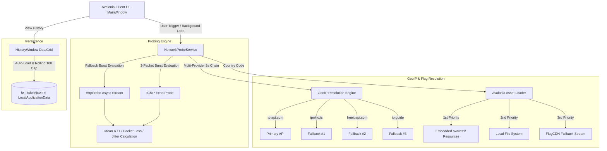

<div align="center">

# 🌐 Iranian Internet & Censorship Monitor

**A high-precision, low-level network diagnostic monitor and censorship analyzer designed for Iranian internet connectivity, domestic intranet routes (NIN), international sanction blocks (Tahrim), and state-level DPI filtering.**

[](https://github.com/behdanisohrab/ping-app/releases)
[](https://dotnet.microsoft.com/download/dotnet/10.0)
[](https://avaloniaui.net/)
[](https://github.com/behdanisohrab/ping-app)
[](LICENSE)

<br/>

[Key Features](#-key-features) • [System Architecture](#-system-architecture) • [Target Matrix](#-categorized-probing-targets) • [Build & Run](#-build--development) • [Legacy Version](#-legacy-version)

</div>

---

## 🌟 Key Features

### 1. ⚡ Advanced Burst Probing & Jitter Measurement
- **3-Packet Burst Statistical Analysis:** Sends multi-sample probe bursts per endpoint to calculate:
  - **Mean Round-Trip Time (RTT in ms)**
  - **Packet Loss Percentage (`%`)**
  - **Mean Absolute Packet Jitter ($\pm\text{ms}$)**
- **Smart Dual-Protocol Adaptation:** Automatically falls back between low-level raw ICMP echo probes and asynchronous HTTP/HTTPS burst requests when ICMP is throttled by intermediate middleboxes.

### 2. 🎨 Dynamic Visual Latency & Quality Grading
Pings are color-coded in real-time based on strict performance and route health thresholds (WCAG 2.2 AA compliant contrast):

| Quality Tier | Latency Threshold | Color Indicator | Typical Meaning |
| :--- | :--- | :--- | :--- |
| **Optimal** | `< 80 ms` | 🟢 Dark Green (`#2E7D32`) | Domestic routing / High-speed direct IXP |
| **Good** | `80 - 160 ms` | 🟢 Forest Green (`#558B2F`) | Standard international routing (Europe/Middle East) |
| **Moderate** | `160 - 260 ms` | 🟡 Amber (`#EF6C00`) | Elevated latency / CDN detour routes |
| **Degraded** | `> 260 ms` | 🔴 Crimson (`#D32F2F`) | Severe congestion, throttling, or satellite links |
| **Impaired** | Any `Loss > 0%` | ⚠️ Highlighted with `%` | Packet drops / DPI queue buffer overflows |

### 3. 🎯 Deep Status Code & Censorship Fingerprinting
Distinguishes between network loss, state filtering, and international sanctions:
- **`200 OK / 3xx Redirect`:** Accessible and clean route.
- **`403 Forbidden / 451 Unavailable For Legal Reasons`:** Sanction Blocked (Tahrim): Destination provider or Cloudflare is actively blocking Iranian ASN/IP ranges.
- **`Timeout (> 1200ms)`:** DPI / Silent Drop: Packet inspection firewall silently discarding SYN packets.
- **`Connection Refused / TCP RST`:** Active DPI Reset Injection: Firewall sending TCP RST flags to kill handshake.

### 4. 🌍 100% Offline Embedded Flag Library
- **304 Embedded Country Flags (`w40` PNGs):** Directly compiled into the executable as Avalonia resources (`avares://PingApp/Assets/flags/*.png`).
- **3-Tier Graceful Resolution:**
  $$\text{Avalonia Resource Stream (Instant)} \longrightarrow \text{Local File System} \longrightarrow \text{CDN Remote Stream}$$
- **Zero Latency UI:** Flags appear instantly without network queries upon IP resolution.

### 5. 🔄 Multi-Provider GeoIP Fallback Chain
Robust 4-tier failover engine with dedicated 3-second timeout protection per provider:

```
[Fetch GeoIP Request]
        │
        ├──► 1. ip-api.com (Primary, HTTP Fast Route)
        │         └──(On Fail/Timeout 3s)
        ├──► 2. ipwho.is (Fallback #1, HTTPS High Accuracy)
        │         └──(On Fail/Timeout 3s)
        ├──► 3. freeipapi.com (Fallback #2, High Rate Limit)
        │         └──(On Fail/Timeout 3s)
        └──► 4. ip.guide (Fallback #3, Lightweight Fallback)
```

### 6. 💾 Persistent IP History Tracking (Last 100 Records)
- Automatically records every IP check into the platform-standard local application data directory:
  - **Linux:** `~/.local/share/IranianInternetMonitor/ip_history.json`
  - **Windows:** `%LocalAppData%\IranianInternetMonitor\ip_history.json`
- **Rolling Cap:** Retains the latest 100 sequential records.
- **Integrated DataGrid:** Searchable and filterable history window.

---

## 📊 Categorized Probing Targets

```
Targets Tested
├── 🌐 Domestic (NIN / National Information Network)
│   ├── whatismyipaddress.com
│   ├── google.com
│   ├── speedtest.net
│   ├── divar.ir
│   ├── yandex.com
│   └── aparat.com
│
├── 🚫 Sanctions (Tahrim / International Restrictions)
│   ├── openai.com
│   ├── amd.com
│   ├── apps.microsoft.com
│   ├── microsoft.com
│   ├── claude.ai
│   ├── cloudflare.com
│   └── adobe.com
│
└── 🔒 Filtered (Censorship / State DPI Blocking)
    ├── 4.4.4.4
    ├── edition.cnn.com
    ├── bbc.com
    ├── youtube.com
    ├── reddit.com
    ├── instagram.com
    ├── telegram.org
    └── pornhub.com
```

---

## 🏗️ System Architecture



---

## 💻 Tech Stack & Requirements

- **Language:** C# 13 / .NET 10
- **UI Framework:** [Avalonia UI](https://avaloniaui.net/) 12+ (XAML, SkiaSharp rendering)
- **Architecture:** MVVM using `CommunityToolkit.Mvvm`
- **Target OS:**
  - **Linux:** Ubuntu 20.04+, Debian 11+, Fedora, Arch (X11 & Wayland)
  - **Windows:** Windows 10, Windows 11 (x64 & ARM64)
  - **macOS:** macOS 12+ (x64 & Apple Silicon)

---

## 🛠️ Build & Development

### 1. Prerequisites
- [.NET 10 SDK](https://dotnet.microsoft.com/download/dotnet/10.0)

### 2. Clone the Repository
```bash
git clone git@github.com:behdanisohrab/ping-app.git
cd ping-app
```

### 3. Run Application
```bash
dotnet run --project src/PingApp/PingApp.csproj
```

### 4. Run Unit Tests
```bash
dotnet test PingApp.sln
```

### 5. Publish Standalone Binaries

```bash
# Linux x64
dotnet publish src/PingApp/PingApp.csproj -c Release -r linux-x64 --no-self-contained

# Windows x64
dotnet publish src/PingApp/PingApp.csproj -c Release -r win-x64 --no-self-contained
```

---

## 📂 Project Structure

```
ping-app/
├── PingApp.sln                         # Solution File
├── PingApp.slnx                        # Modern XML Solution File
├── Directory.Build.props               # Common Build Properties
├── nuget.config                        # NuGet Package Source Configuration
├── src/
│   └── PingApp/
│       ├── Assets/                     # 304 Embedded Country Flags + App Icon
│       ├── Models/                     # ProbeResult, GeoIpResult, IpHistoryRecord, ProbeTarget
│       ├── Services/                   # NetworkProbeService, HistoryService
│       ├── ViewModels/                 # MainViewModel, HistoryViewModel
│       ├── Views/                      # MainWindow.axaml, HistoryWindow.axaml
│       ├── App.axaml                   # Application Definition & Styles
│       ├── Program.cs                  # Desktop Bootstrapper
│       └── PingApp.csproj              # Project File (net10.0)
├── tests/
│   └── PingApp.Tests/                  # xUnit Unit Test Suite
├── legacy/                             # Legacy .NET Framework 4.7.2 WinForms project
└── README.md                           # Documentation
```

---

## 📦 Legacy Version

The original Windows-only .NET Framework 4.7.2 Windows Forms application is preserved in the [`legacy/`](legacy/) directory for historical reference and backwards compatibility.

---

## 📄 License & Attribution

Distributed under the **MIT License**. See [LICENSE](LICENSE) for full details.
Original implementation by [Mahziyar](https://github.com/mahziyar-azz).
Modernized and ported to .NET 10 + Avalonia by [Sohrab Behdani](https://github.com/behdanisohrab).
